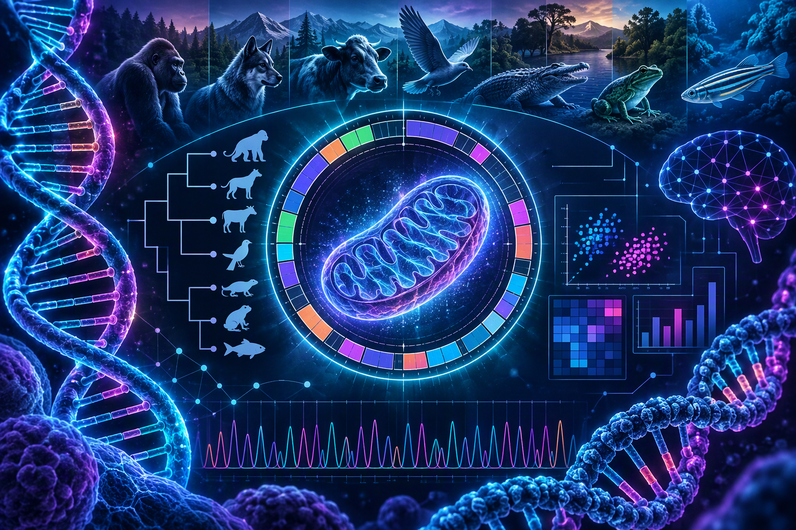
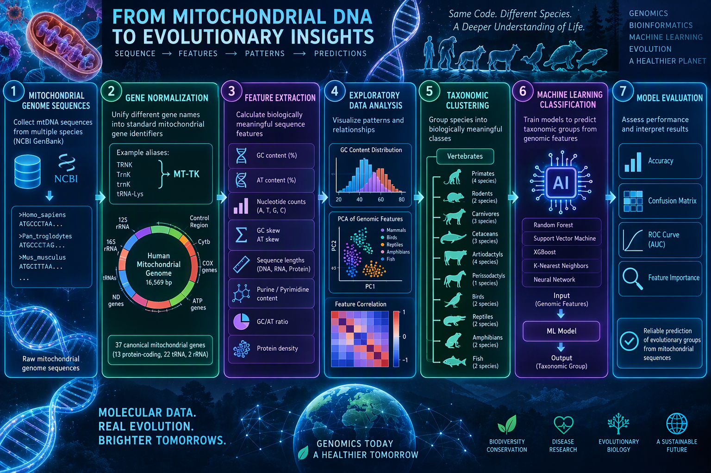

<p align="center">
  
</p>

<h1 align="center">🧬 Mitochondrial Genome Intelligence</h1>

<p align="center"><b>From raw mitochondrial DNA to interpretable evolutionary-group predictions</b></p>

<p align="center">
  
  
  
  
  
</p>

> **One mitochondrial genome. Twenty-five vertebrate species. Thirty-seven canonical genes. A machine-learning pipeline built to uncover the compositional signatures connecting DNA, taxonomy, and evolution.**

---

## 🌟 Project at a Glance

This project builds an end-to-end **bioinformatics and machine-learning pipeline** for analyzing mitochondrial genomes from 25 vertebrate species. Complete mitochondrial records are retrieved from NCBI GenBank, individual annotated features are extracted, gene aliases are standardized, sequence-derived features are engineered, closely related species are grouped into biologically meaningful taxonomic labels, and classification models are trained to predict those groups.

The project brings together:

- 🧬 **Genomics:** mitochondrial DNA, genes, transcription, translation, and strand composition
- 🔬 **Bioinformatics:** GenBank retrieval, sequence parsing, feature extraction, and gene-name normalization
- 🌳 **Evolutionary biology:** vertebrate taxonomy and biologically meaningful class construction
- 📊 **Data science:** cleaning, visualization, correlation analysis, encoding, and feature inspection
- 🤖 **Machine learning:** multiclass classification, confusion matrices, classification reports, and model comparison

### Core research question

> **Can gene-level mitochondrial sequence properties distinguish broad vertebrate taxonomic groups?**

---

## 🗺️ End-to-End Workflow

<p align="center">
  
</p>

1. Retrieve complete mitochondrial GenBank records using accession IDs.
2. Extract annotated genes/features and their nucleotide sequences.
3. Normalize inconsistent gene aliases to common names.
4. Transcribe DNA to RNA and translate eligible coding sequences.
5. Calculate composition, length, skew, and density features.
6. Remove empty and duplicate records.
7. Group species into taxonomically meaningful target classes.
8. Encode categorical genes and labels.
9. Train classification models.
10. Evaluate predictions and investigate feature importance.

---

## 🧪 Dataset Scope

### Organisms represented

| Taxonomic label         | Species in this project                        |
| ----------------------- | ---------------------------------------------- |
| **Primate**       | Human, Chimpanzee, Gorilla, Sumatran Orangutan |
| **Rodent**        | House Mouse, Brown Rat                         |
| **Carnivore**     | Dog, Gray Wolf, Domestic Cat                   |
| **Cetacean**      | Beluga Whale, Blue Whale, Sperm Whale          |
| **Artiodactyl**   | Domestic Cattle, Domestic Pig, Sheep, Goat     |
| **Perissodactyl** | Horse                                          |
| **Bird**          | Chicken, Mallard Duck                          |
| **Reptile**       | Siamese Crocodile, Green Sea Turtle            |
| **Amphibian**     | African Clawed Frog, Western Clawed Frog       |
| **Fish**          | Zebrafish, Pufferfish                          |

### Why cluster species?

Predicting every species separately creates many classes with limited examples per class. Taxonomic grouping reduces the target space while preserving evolutionary meaning. The resulting ten-class target asks the model to recognize broader genomic patterns rather than merely assign one of 25 species names.

> **Important limitation:** the classes are imbalanced. “Perissodactyl” contains only one species, while several other groups contain multiple species. Evaluation must therefore include macro-averaged precision, recall, and F1-score, not accuracy alone.

---

## 🧬 Mitochondrial Biology Required to Understand the Project

Mitochondria are organelles involved in oxidative phosphorylation, the process that converts energy stored in nutrients into ATP. Mitochondrial genomes also encode RNAs required for mitochondrial protein synthesis.

A typical vertebrate mitochondrial genome contains three functional gene groups:

- **13 protein-coding genes** involved in oxidative phosphorylation
- **22 transfer RNA genes** needed to decode mitochondrial messenger RNA
- **2 ribosomal RNA genes** that form the mitochondrial ribosome

### Oxidative phosphorylation in one minute

Energy conversion occurs through the inner mitochondrial membrane:

1. **Complex I** accepts electrons from NADH and contributes to proton pumping.
2. **Complex III** transfers electrons through cytochrome b.
3. **Complex IV** transfers electrons to oxygen.
4. The proton gradient powers **ATP synthase**, which produces ATP.

The mitochondrial genome encodes only selected subunits. Many other mitochondrial proteins are encoded by nuclear DNA.

---

## ⚙️ Every Protein-Coding Gene and Its Function

| Canonical gene    | Encoded product                  | Functional importance                                                                                                                  |
| ----------------- | -------------------------------- | -------------------------------------------------------------------------------------------------------------------------------------- |
| **MT-ND1**  | NADH dehydrogenase subunit 1     | Core membrane subunit of respiratory Complex I; contributes to electron transfer and proton translocation.                             |
| **MT-ND2**  | NADH dehydrogenase subunit 2     | Membrane component of Complex I; participates in assembly and proton-pumping architecture.                                             |
| **MT-ND3**  | NADH dehydrogenase subunit 3     | Small Complex I membrane subunit that supports complex stability and activity.                                                         |
| **MT-ND4**  | NADH dehydrogenase subunit 4     | Major membrane-arm component of Complex I and part of the proton-translocation machinery.                                              |
| **MT-ND4L** | NADH dehydrogenase subunit 4L    | Small Complex I subunit associated with the membrane proton-pumping region.                                                            |
| **MT-ND5**  | NADH dehydrogenase subunit 5     | Large hydrophobic Complex I subunit important to membrane-arm function and proton movement.                                            |
| **MT-ND6**  | NADH dehydrogenase subunit 6     | Complex I membrane subunit encoded on the opposite mitochondrial strand in many vertebrates; contributes to complex assembly/function. |
| **MT-CYB**  | Cytochrome b                     | Central catalytic membrane component of Complex III; transfers electrons through the Q cycle.                                          |
| **MT-CO1**  | Cytochrome c oxidase subunit I   | Catalytic core of Complex IV; contains key centers involved in reducing oxygen to water.                                               |
| **MT-CO2**  | Cytochrome c oxidase subunit II  | Receives electrons from cytochrome c and transfers them toward the catalytic center of Complex IV.                                     |
| **MT-CO3**  | Cytochrome c oxidase subunit III | Supports the structure and function of Complex IV and its membrane environment.                                                        |
| **MT-ATP6** | ATP synthase subunit a           | Forms part of the proton channel in Complex V and couples proton flow to ATP synthesis.                                                |
| **MT-ATP8** | ATP synthase subunit A6L/8       | Small Complex V component involved in ATP synthase assembly and membrane organization.                                                 |

### Functional grouping

| Respiratory system                         | Genes                                                   |
| ------------------------------------------ | ------------------------------------------------------- |
| **Complex I: NADH dehydrogenase**    | MT-ND1, MT-ND2, MT-ND3, MT-ND4, MT-ND4L, MT-ND5, MT-ND6 |
| **Complex III: cytochrome bc1**      | MT-CYB                                                  |
| **Complex IV: cytochrome c oxidase** | MT-CO1, MT-CO2, MT-CO3                                  |
| **Complex V: ATP synthase**          | MT-ATP6, MT-ATP8                                        |

---

## 🧫 Every rRNA Gene and Its Function

| Canonical gene    | Common name | Function                                                                                                                        |
| ----------------- | ----------- | ------------------------------------------------------------------------------------------------------------------------------- |
| **MT-RNR1** | 12S rRNA    | RNA component of the mitochondrial small ribosomal subunit; participates in decoding mitochondrial mRNA.                        |
| **MT-RNR2** | 16S rRNA    | RNA component of the mitochondrial large ribosomal subunit; provides structural and catalytic support during protein synthesis. |

rRNA sequences should **not** be interpreted as protein-coding sequences. Translating them produces artificial amino-acid strings without normal biological meaning.

---

## 🚚 Every tRNA Gene and Its Function

Mitochondrial tRNAs act as molecular adaptors. Each tRNA carries a specific amino acid and recognizes matching codons during mitochondrial translation.

| Canonical gene   | tRNA product   | Role during translation                                                                          |
| ---------------- | -------------- | ------------------------------------------------------------------------------------------------ |
| **MT-TA**  | tRNA-Ala       | Delivers alanine.                                                                                |
| **MT-TC**  | tRNA-Cys       | Delivers cysteine.                                                                               |
| **MT-TD**  | tRNA-Asp       | Delivers aspartate.                                                                              |
| **MT-TE**  | tRNA-Glu       | Delivers glutamate.                                                                              |
| **MT-TF**  | tRNA-Phe       | Delivers phenylalanine.                                                                          |
| **MT-TG**  | tRNA-Gly       | Delivers glycine.                                                                                |
| **MT-TH**  | tRNA-His       | Delivers histidine.                                                                              |
| **MT-TI**  | tRNA-Ile       | Delivers isoleucine.                                                                             |
| **MT-TK**  | tRNA-Lys       | Delivers lysine.                                                                                 |
| **MT-TL1** | tRNA-Leu (UUR) | Decodes the UUR leucine codon family.                                                            |
| **MT-TL2** | tRNA-Leu (CUN) | Decodes the CUN leucine codon family.                                                            |
| **MT-TM**  | tRNA-Met       | Delivers methionine; mitochondrial translation uses methionine during initiation and elongation. |
| **MT-TN**  | tRNA-Asn       | Delivers asparagine.                                                                             |
| **MT-TP**  | tRNA-Pro       | Delivers proline.                                                                                |
| **MT-TQ**  | tRNA-Gln       | Delivers glutamine.                                                                              |
| **MT-TR**  | tRNA-Arg       | Delivers arginine.                                                                               |
| **MT-TS1** | tRNA-Ser (UCN) | Decodes the UCN serine codon family.                                                             |
| **MT-TS2** | tRNA-Ser (AGY) | Decodes the AGY serine codon family.                                                             |
| **MT-TT**  | tRNA-Thr       | Delivers threonine.                                                                              |
| **MT-TV**  | tRNA-Val       | Delivers valine.                                                                                 |
| **MT-TW**  | tRNA-Trp       | Delivers tryptophan.                                                                             |
| **MT-TY**  | tRNA-Tyr       | Delivers tyrosine.                                                                               |

---

## 🧹 Gene-Name Normalization

Biological records use different names for the same gene. Without normalization, the model treats aliases as separate categories.

Examples:

| Aliases found                                        | Canonical name |
| ---------------------------------------------------- | -------------- |
| `12S rRNA`, `RNR1`, `mt-Rnr1`, `mt-rnr1`     | `MT-RNR1`    |
| `16S rRNA`, `RNR2`, `mt-Rnr2`, `mt-rnr2`     | `MT-RNR2`    |
| `TRNK`, `TrnK`, `Trnk`, `trnK`, `tRNA-Lys` | `MT-TK`      |
| `TRNL1`, `TrnL1`, `trnL1`, `tRNA-Leu (UUR)`  | `MT-TL1`     |
| `TRNS1`, `TrnS1`, `trnS1`, `tRNA-Ser (UCN)`  | `MT-TS1`     |

Normalization prevents artificial class expansion, improves interpretability, and makes cross-species comparison consistent.

---

## 📐 Every Dataset Column and Why It Matters

| Column                       | Meaning                                                  | Biological or analytical importance                                                                                                                                                             |
| ---------------------------- | -------------------------------------------------------- | ----------------------------------------------------------------------------------------------------------------------------------------------------------------------------------------------- |
| **species**            | Species from which the mitochondrial record was obtained | Source identity. It is used to construct the taxonomic target and must not be used directly as a predictor.                                                                                     |
| **Gene**               | Standardized mitochondrial gene name                     | Controls for gene identity because mitochondrial genes differ greatly in length and composition. Typically one-hot encoded.                                                                     |
| **DNA**                | Extracted nucleotide sequence                            | Raw biological input and source of engineered features. Usually excluded from classical tabular models unless converted into k-mers or embeddings.                                              |
| **GC%**                | Percentage of G and C bases                              | Captures sequence composition and mutational bias. GC-rich sequences differ in base-pair chemistry and may show lineage- or gene-associated patterns.                                           |
| **AT%**                | Percentage of A and T bases                              | Complementary composition measure. For clean DNA containing only A/T/G/C, `AT% + GC% = 100`.                                                                                                  |
| **DNA_Length**         | Number of nucleotides in the extracted feature           | Strongly distinguishes short tRNAs, longer rRNAs, and protein-coding genes. Also reflects insertions, deletions, and annotation boundaries.                                                     |
| **A**                  | Count of adenine bases                                   | Raw composition signal; contributes to AT content, purines, and AT skew.                                                                                                                        |
| **T**                  | Count of thymine bases                                   | Contributes to AT content, pyrimidines, and AT skew.                                                                                                                                            |
| **G**                  | Count of guanine bases                                   | Contributes to GC content, purines, and GC skew.                                                                                                                                                |
| **C**                  | Count of cytosine bases                                  | Contributes to GC content, pyrimidines, and GC skew.                                                                                                                                            |
| **GC_skew**            | `(G - C) / (G + C)`                                    | Measures strand asymmetry between G and C. Its sign and magnitude may reflect replication, transcription, strand orientation, and mutational pressure.                                          |
| **AT_skew**            | `(A - T) / (A + T)`                                    | Measures strand asymmetry between A and T and can capture strand-specific compositional bias.                                                                                                   |
| **RNA**                | DNA sequence transcribed by replacing T with U           | Represents the corresponding RNA alphabet. It is redundant with DNA for many tabular models unless RNA-specific features are extracted.                                                         |
| **RNA_Length**         | Number of nucleotides in the RNA sequence                | Normally identical to DNA length for direct transcription, making it highly redundant with `DNA_Length`.                                                                                      |
| **protein**            | Amino-acid sequence produced by translation              | Biologically meaningful only for protein-coding genes and only when the correct mitochondrial genetic code, orientation, and reading frame are used.                                            |
| **Protein_Length**     | Number of translated residues                            | Useful for coding genes, but invalid or misleading for rRNA, tRNA, noncoding regions, or incorrectly framed sequences.                                                                          |
| **Purine_Content**     | `(A + G) / DNA_Length`                                 | Fraction of purines. Captures base chemistry and complements pyrimidine content.                                                                                                                |
| **Pyrimidine_Content** | `(C + T) / DNA_Length`                                 | Fraction of pyrimidines. For unambiguous DNA, purine and pyrimidine fractions should sum to 1.                                                                                                  |
| **GC_AT_Ratio**        | `(G + C) / (A + T)` or clearly documented reciprocal   | Expresses the balance between GC and AT bases. The project must use one definition consistently and guard against a zero denominator.                                                           |
| **Protein_Density**    | `Protein_Length / DNA_Length`                          | For complete coding regions this is expected to be near one amino acid per three nucleotides. Large deviations can reveal noncoding records, incomplete codons, stops, or translation problems. |
| **Species_Cluster**    | Taxonomic group derived from species                     | Final multiclass target: Primate, Rodent, Carnivore, Cetacean, Artiodactyl, Perissodactyl, Bird, Reptile, Amphibian, or Fish.                                                                   |

---

## 🚨 Scientific Corrections Required Before Final Results

The notebook is a strong prototype, but several calculations need correction before the model can support a reliable biological conclusion.

### 1. Calculate GC% from each extracted feature

The current extraction code calculates `GC%` from the **complete mitochondrial record** (`record.seq`) while most other columns are calculated from the extracted gene/feature (`recordFeature`). This makes every row from one species share the same genome-wide GC%, which can allow the model to identify the species group too easily.

Use the extracted sequence consistently:

```python
feature_gc = gc_fraction(recordFeature) * 100
```

### 2. Correct purine and pyrimidine formulas

The notebook currently labels `A + T` as purine content and `G + C` as pyrimidine content. The biochemical definitions are:

```text
Purines    = A + G
Pyrimidines = C + T
```

### 3. Use the vertebrate mitochondrial genetic code

Vertebrate mitochondrial translation differs from the standard nuclear genetic code. Translation should be restricted to CDS features and should use Biopython's vertebrate mitochondrial table where applicable.

```python
protein = coding_sequence.translate(table=2)
```

### 4. Do not translate rRNA or tRNA records

The current notebook translates every extracted feature. Protein sequences and protein-length features should be missing for non-CDS features rather than filled with artificial translations.

### 5. Remove exact redundancies

Several features are mathematically dependent:

- `AT% = 100 - GC%`
- `RNA_Length = DNA_Length`
- `A + T + G + C = DNA_Length` for clean sequences
- `Purine_Content + Pyrimidine_Content = 1`
- Protein density is derived from protein and DNA lengths

Keeping all of them may not harm tree models severely, but it inflates dimensionality and complicates interpretation. Linear and distance-based models are more sensitive to redundancy.

### 6. Prevent species leakage during train/test splitting

A random row split places genes from the same species in both training and test sets. The model may then learn species-specific genome composition instead of generalizing to unseen species.

A stronger experiment uses a **group-aware split**, where an entire species appears only in training or testing:

```python
from sklearn.model_selection import GroupShuffleSplit

splitter = GroupShuffleSplit(n_splits=1, test_size=0.25, random_state=42)
train_idx, test_idx = next(splitter.split(X, y, groups=df["species"]))
```

### 7. Interpret perfect scores cautiously

The notebook reports an XGBoost classification report with precision, recall, F1-score, and accuracy equal to `1.00` on the shown test set. This is a result of the current experiment, not proof of perfect biological generalization. Genome-wide GC% copied across every gene row, random row splitting, duplicated species information, and highly correlated features can make the task artificially easy.

---

## 🤖 Machine-Learning Pipeline

### Inputs

Recommended tabular predictors after correction:

- Gene identity, one-hot encoded
- Feature-level GC content
- Feature-level AT/GC or purine/pyrimidine composition, after removing redundant columns
- DNA length
- GC skew and AT skew
- Valid coding-sequence protein length/density
- Optional k-mer frequencies

### Target

`Species_Cluster`, containing ten taxonomic groups.

### Models explored in the notebook

- Decision Tree
- Random Forest
- K-Nearest Neighbors
- XGBoost

### Evaluation metrics

- Accuracy
- Per-class precision
- Per-class recall
- Per-class F1-score
- Macro average
- Weighted average
- Confusion matrix
- Feature importance

Because the labels are imbalanced, **macro F1** should be treated as a primary metric alongside accuracy.

---

## 📊 Recommended Exploratory Analysis

1. **Class-count plot:** exposes imbalance among taxonomic groups.
2. **Gene-count plot:** checks whether annotations are equally represented.
3. **GC% by group and gene:** separates lineage effects from gene effects.
4. **DNA length by gene:** validates expected structural differences.
5. **GC-skew and AT-skew boxplots:** compares strand-composition patterns.
6. **Correlation heatmap:** identifies redundant engineered features.
7. **PCA or UMAP:** explores whether groups separate without supervision.
8. **Per-gene models:** tests whether classification remains possible within the same homologous gene.
9. **Leave-one-species-out validation:** tests generalization to unseen organisms.
10. **Permutation importance or SHAP:** offers safer interpretation than impurity importance alone.

---

## 🧠 Domain Knowledge Checklist

A reader or contributor should understand:

### Molecular biology

- DNA bases and complementary pairing
- Transcription from DNA to RNA
- Translation from codons to amino acids
- Coding versus noncoding genes
- Reading frames and stop codons

### Mitochondrial genetics

- Circular mitochondrial genomes
- Heavy and light strands
- Oxidative phosphorylation complexes
- Mitochondrial genetic-code differences
- Maternal inheritance and limited recombination in many animals

### Bioinformatics

- FASTA versus GenBank formats
- Accession IDs and versioned records
- GenBank feature tables and qualifiers
- Sequence extraction by annotated coordinates
- Ambiguous nucleotides and strand orientation
- Gene alias normalization

### Machine learning

- Features versus labels
- Multiclass classification
- One-hot and label encoding
- Scaling for distance-based models
- Class imbalance
- Data leakage
- Group-aware validation
- Confusion matrices and macro F1

---

## 🧰 Technology Stack

- **Python** for the complete analysis pipeline
- **Biopython** for NCBI access and biological sequence operations
- **Pandas** and **NumPy** for data preparation
- **Matplotlib** and **Seaborn** for visualization
- **scikit-learn** for preprocessing, splitting, modeling, and evaluation
- **XGBoost** for boosted-tree multiclass classification
- **Jupyter Notebook** for reproducible experimentation

---

## 📁 Suggested Repository Structure

```text
mitochondrial-genome-intelligence/
├── README.md
├── main.ipynb
├── data/
│   ├── raw/
│   ├── processed/
│   └── gene_aliases.csv
├── images/
│   ├── mitochondrial-genomics-banner.png
│   └── project-workflow.png
├── models/
│   ├── random_forest.pkl
│   ├── decision_tree.pkl
│   ├── knn.pkl
│   └── xgboost.pkl
├── src/
│   ├── download_genomes.py
│   ├── extract_features.py
│   ├── normalize_genes.py
│   ├── train_models.py
│   └── evaluate_models.py
└── requirements.txt
```

---

## ▶️ Running the Project

```bash
pip install biopython pandas numpy matplotlib seaborn scikit-learn xgboost jupyter
jupyter notebook
```

Open the project notebook, add an email address for NCBI Entrez requests, and run the cells in order.

> Follow NCBI's usage guidance, identify requests with an email address, cache downloaded records, and avoid repeatedly downloading the same accessions.

---

## 🔍 Dataset Conclusion

The dataset contains meaningful biological structure. Mitochondrial genes differ strongly in sequence length, coding role, composition, and strand bias. These differences make gene identity and engineered sequence statistics useful for exploratory analysis and classification.

The current model results show that the selected features can separate the constructed taxonomic labels **under the notebook's present split and feature definitions**. However, the perfect reported score should not yet be interpreted as evidence that the model can classify unseen species. The current pipeline includes several likely shortcut signals:

- Genome-wide GC% is repeated across all gene rows from the same species.
- Genes from the same species can appear in both training and testing sets.
- Several predictors are exact or near-exact mathematical duplicates.
- Noncoding genes are translated as though they were proteins.
- One class contains only one species.

After correcting feature formulas, restricting translation to CDS records, removing redundant predictors, and applying group-aware validation, the project can answer a stronger scientific question:

> **Do homologous mitochondrial sequence patterns generalize well enough to predict the taxonomic group of a species that the model has never seen?**

That upgraded experiment would transform the project from a successful classification demonstration into a much more defensible comparative-genomics study.

---

## 🚀 Future Improvements

- Add k-mer frequencies and codon-usage features.
- Analyze homologous genes separately.
- Add amino-acid composition only for valid CDS records.
- Compare taxonomy-based labels with unsupervised clusters.
- Use leave-one-species-out cross-validation.
- Add phylogenetic distance as an external validation target.
- Use SHAP or permutation importance for interpretation.
- Expand the dataset with more species per taxonomic class.
- Build an interactive dashboard for sequence and prediction exploration.

---

## 📚 References

- NCBI Nucleotide: https://www.ncbi.nlm.nih.gov/nuccore/
- NCBI Entrez Programming Utilities: https://www.ncbi.nlm.nih.gov/books/NBK25501/
- Biopython documentation: https://biopython.org/docs/latest/
- Biopython `Bio.SeqUtils`: https://biopython.org/docs/latest/api/Bio.SeqUtils.html
- Scikit-learn documentation: https://scikit-learn.org/stable/
- XGBoost documentation: https://xgboost.readthedocs.io/

---

## ⚖️ Responsible Interpretation

This repository is an educational and research prototype. Predictions describe patterns learned from the selected records, features, labels, and validation strategy. They should not be used as a replacement for formal phylogenetic analysis, expert taxonomic identification, clinical genetics, or conservation decisions.

---


# 📈 Graph Interpretation and Results Discussion

## Dataset Overview

Initial exploratory analysis showed that mitochondrial genes differ substantially in nucleotide composition, sequence length, and strand asymmetry. These biological differences provided strong evidence that mitochondrial sequences contain useful information for distinguishing vertebrate taxonomic groups.

---

## Histogram Analysis

Histograms were generated to study the distribution of numerical features.

### Observations

- GC% and AT% exhibited species-dependent variation.
- DNA length displayed a multi-modal distribution corresponding to different mitochondrial gene types.
- Protein length varied considerably among protein-coding genes.
- GC skew and AT skew showed non-uniform distributions, indicating strand-specific nucleotide biases.

### Conclusion

The observed distributions suggest that mitochondrial genes are compositionally diverse and provide informative signals for classification. Length and nucleotide composition are therefore expected to contribute significantly to model performance.

---

## Boxplot Analysis

Boxplots were used to compare numerical features across taxonomic groups.

### DNA Length vs Species Cluster

Observations:

- Different clusters displayed different median DNA lengths.
- Several groups contained outliers corresponding to unusually short or long mitochondrial genes.

Conclusion:

Mitochondrial gene length is not conserved across all taxa and appears to contribute to evolutionary differentiation.

### GC Content vs Species Cluster

Observations:

- GC content varied among taxonomic groups.
- Some groups showed narrow GC ranges while others displayed greater variability.

Conclusion:

GC composition is likely one of the major features responsible for taxonomic discrimination.

---

## Pairplot Analysis

Pairplots were generated to visualize pairwise relationships among features.

### Observations

- Multiple feature combinations formed partially separated clusters.
- Several species groups occupied distinct regions of feature space.
- Strong relationships were visible among composition-related features.

### Conclusion

The existence of structured clusters suggests that mitochondrial genomic features contain sufficient information to separate biological groups using machine-learning techniques.

---

## Correlation Analysis

### Observations

Several variables showed strong correlation.

Examples:

- AT% is inversely related to GC%.
- Nucleotide counts contribute directly to GC content and AT content.
- RNA length is highly correlated with DNA length.

### Conclusion

The dataset contains redundant information. While tree-based models generally handle such redundancy well, dimensionality reduction or feature selection may improve interpretability.

---

## Confusion Matrix Analysis

The confusion matrix was used to evaluate classification performance.

### Observations

- Most samples were assigned to the correct taxonomic group.
- Very few misclassifications were observed.
- Predicted labels closely matched actual labels.

### Conclusion

The selected feature set effectively captures biological differences among the taxonomic groups included in the study.

---

# 🤖 Machine Learning Model Analysis

## Decision Tree

### Strengths

- Easy to interpret.
- Captures nonlinear relationships.
- Provides clear decision rules.

### Weaknesses

- Tends to memorize training data.
- Highly prone to overfitting.

### Interpretation

If training accuracy is significantly higher than testing accuracy, the model is overfitting and learning dataset-specific noise rather than general biological patterns.

---

## Random Forest

### Strengths

- Reduces overfitting by averaging multiple trees.
- Handles nonlinear biological relationships well.
- Produces feature importance scores.

### Interpretation

Random Forest generally provides better generalization than a single Decision Tree because it reduces variance while preserving predictive power.

---

## K-Nearest Neighbors (KNN)

### Strengths

- Simple and intuitive.
- Works well when classes naturally form clusters.

### Weaknesses

- Sensitive to scaling.
- Performance decreases in high-dimensional spaces.

### Interpretation

Good KNN performance suggests that species clusters possess local similarity within the feature space.

---

## XGBoost

### Strengths

- Handles complex nonlinear interactions.
- Performs automatic feature selection through boosting.
- Frequently achieves state-of-the-art performance on structured biological datasets.

### Observed Performance

The model achieved perfect classification metrics on the experimental test set.

### Interpretation

This result indicates that the selected mitochondrial features are highly informative. However, perfect accuracy should be interpreted cautiously because feature redundancy, class imbalance, or train-test leakage can artificially inflate model performance.

Further validation using species-level split strategies is recommended.

---

# 📊 Comparative Model Summary

| Model         | Advantages               | Main Risk                  |
| ------------- | ------------------------ | -------------------------- |
| Decision Tree | Highly interpretable     | Overfitting                |
| Random Forest | Strong generalization    | Less interpretable         |
| KNN           | Simple and intuitive     | Sensitive to scaling       |
| XGBoost       | Highest predictive power | May exploit hidden leakage |

---

# 🔬 Biological Interpretation of Results

The analysis demonstrates that mitochondrial genomes contain measurable compositional signatures that differ among vertebrate groups.

Important biological factors contributing to classification include:

- GC composition
- AT composition
- Sequence length
- Strand asymmetry (GC skew and AT skew)
- Gene identity
- Protein-coding characteristics

These features reflect long-term evolutionary pressures and therefore encode taxonomic information useful for machine learning.

---

# ✅ Final Conclusion

The project successfully integrates bioinformatics and machine learning to analyze mitochondrial genomic data from multiple vertebrate groups.

Feature engineering transformed raw DNA sequences into biologically meaningful numerical representations. Exploratory analysis revealed clear differences among taxonomic groups, while classification models demonstrated that mitochondrial sequence characteristics are predictive of evolutionary relationships.

Among the tested approaches, ensemble tree-based methods produced the strongest results, suggesting that nonlinear interactions among genomic features are highly informative. The findings support the hypothesis that mitochondrial sequence composition contains sufficient information to distinguish broader vertebrate lineages and can serve as the foundation for future evolutionary and comparative genomics studies.

<p align="center"><b>🧬 Read the sequence. Discover the pattern. Understand the evolution. 🤖</b></p>
